# Hi, I’m Pablo Barrera

Software engineer building self-hosted tools, community software, and games.
Currently working mostly with Java, Dart/Flutter and Python!

**[Checkout my portfolio](https://pbarr.dev)**

## Technologies

**Development**  

**Infrastructure**  

## Current work

###  [Simple Voice App / Svg-App](https://github.com/TheodoreMeyer/Svg-App)

**Active developer**

I’m currently the sole developer of this Flutter Android app, which lets Bedrock players join voice and server chat. My work spans native audio, connectivity, and the application interface.

### [SimpleVoice-Geyser](https://github.com/TheodoreMeyer/SimpleVoice-Geyser)

**Active contributor**

I actively contribute to the plugin that brings Simple Voice Chat to Minecraft Bedrock players, with ongoing work across audio, connectivity, and compatibility.

## GitHub activity

<picture>
  <source media="(prefers-color-scheme: dark)" srcset="./profile/stats-dark.svg">
  
</picture>
<picture>
  <source media="(prefers-color-scheme: dark)" srcset="./profile/languages-dark.svg">
  
</picture>

## Main Personal Projects

**[Orexa Panel](https://github.com/pbarrera813/MC-AdPanel)** — Browser-based Minecraft server administration with live consoles, file management, plugins, and backups.  
*Go · TypeScript · React · Docker*

**[Nitori](https://github.com/pbarrera813/Discord-bot)** — A Discord bot combining moderation, AI conversation, football information, and community tools.  
*Python*

**[Pac-Man](https://github.com/pbarrera813/Pacman-Game)** — A recreation of the classic arcade game.  
*C++ · SDL2*
